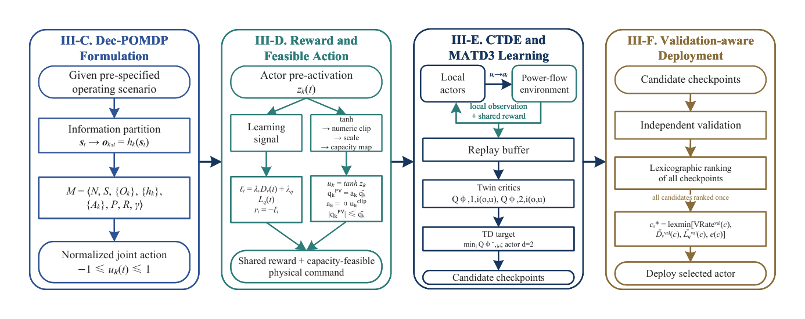
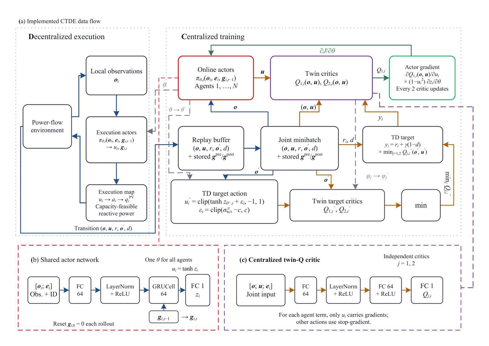
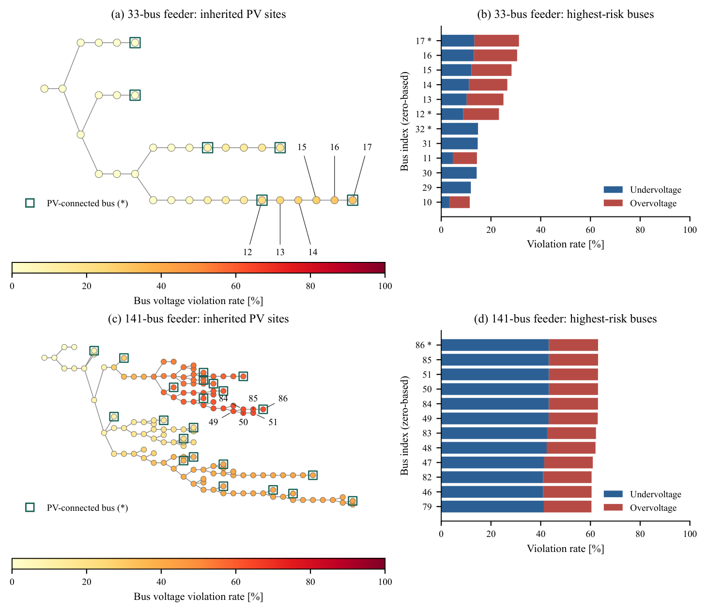
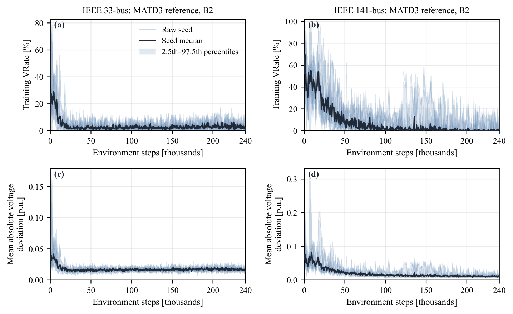
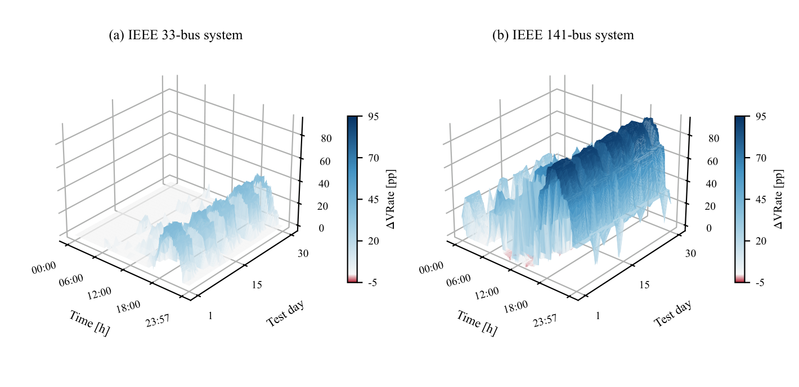
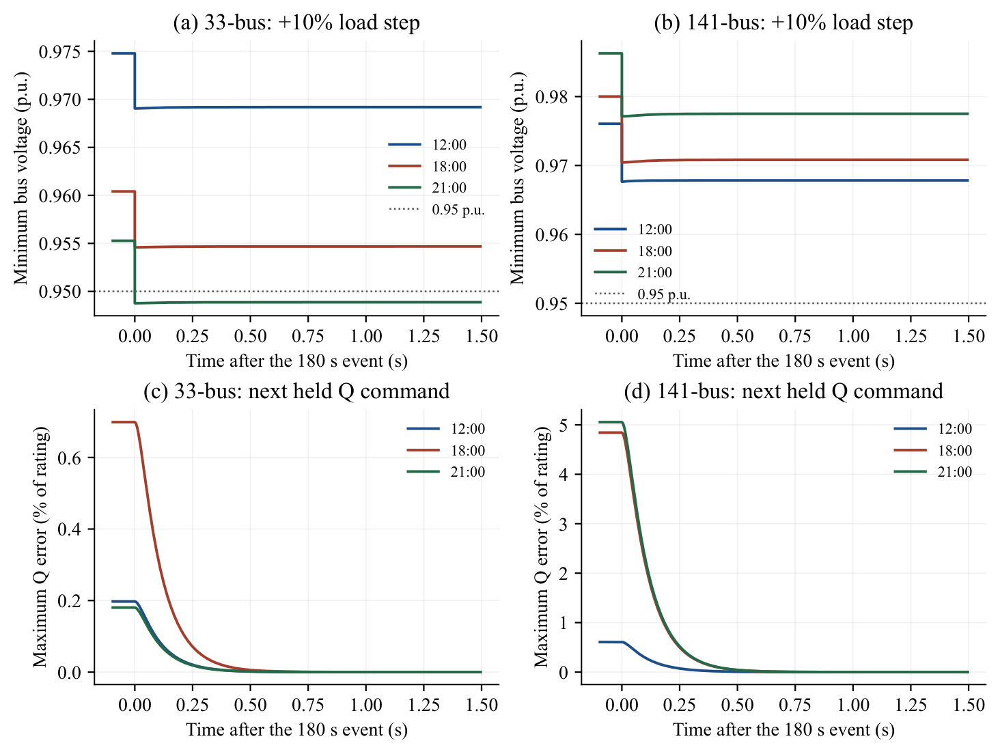

# IR-CRPC: Integrated Risk-Oriented Coordinated Reactive Power Control

Code for the paper *"Integrated Risk-Oriented Coordinated Reactive Power Control for High-Penetration Photovoltaic Distribution Networks"*.

## Framework Overview



IR-CRPC coordinates reactive power across multiple PV inverters on radial distribution feeders using zone-limited observations and capacity-feasible action mapping:

- **Offline QSTS screening** characterizes voltage risk and identifies weak buses
- **Dec-POMDP formulation** with zone-based observations
- **Capacity-feasible action mapping** enforces inverter P-Q limits
- **CTDE policy learning** with an adapted MATD3 reference solver
- **Frozen evaluation protocol** with chronological data splits

## Architecture



The adapted MATD3 reference uses decentralized execution (zone observations only) with centralized training (shared conditional critic). Actor and target updates occur every two critic optimizer steps.

## Weak-Bus Diagnosis



Training-period voltage risk ranking across both feeders (7,984 snapshots per network, κ = 1.5, q = 0). On the 141-bus feeder, the ten highest-risk buses all lie in zone 4; only bus 86 hosts a co-located PV inverter.

## Training Dynamics



Training convergence of the adapted MATD3 reference under B2 sampling: ten independent seeds per network, 240,000 environment steps per run.

## Control Effect



Signed VRate reduction at each matched timestamp (zero-reactive baseline minus the mean of ten reference-B2 policies). Blue = improvement, red = deterioration.

## Converter-Level Stability



WECC-modeled converter responses at recorded operating points. The inverters track the framework's reactive-power commands within 0.44 s (spectral abscissa −9.5 to −10 s⁻¹).

## Data

Network topology files (`model.p`) and inverter parameters are included in `data/`. The 3-minute PV and load time-series files (too large for GitHub) are from the [MAPDN benchmark](https://github.com/FateMurphy/SE-MAPDN); download them separately and place them in the corresponding `data/case*/` directories:

```
data/case33_3min_final/
├── model.p                  ← included
├── pv_active.csv            ← download from MAPDN
├── load_active.csv          ← download from MAPDN
└── load_reactive.csv        ← download from MAPDN

data/case141_3min_final/
├── model.p                  ← included
├── pv_active.csv            ← download from MAPDN
├── load_active.csv          ← download from MAPDN
└── load_reactive.csv        ← download from MAPDN
```

Inverter parameters for the implemented configuration: `data/case*_inverter_parameters.csv`.

## Requirements

- Python 3.10+
- PyTorch >= 2.0
- Pandapower >= 3.0
- NumPy, SciPy, pandas

```bash
pip install -r requirements.txt
```

## Repository Structure

```
ir-crpc/
├── environments/          # MAPDN-based voltage control environment
│   └── var_voltage_control/
├── models/                # Neural network policies (MATD3, MADDPG, MAPPO, FACMADDPG)
├── learning_algorithms/   # PPO and shared training logic
├── utilities/             # Replay buffer, trainer, action mapping
├── args/alg_args/         # Solver hyperparameter configs (YAML)
├── experiments/           # Training, evaluation, and analysis scripts
└── tests/                 # Unit tests
```

## Quick Start

### Train a policy

```python
from experiments.run_revision_training import main
main()  # trains the adapted MATD3 reference with B2 sampling
```

### Evaluate on the frozen test set

```python
from experiments.fixed_test_protocol import evaluate_policy_fixed_days
```

### Weak-bus diagnosis

```python
from experiments.round2_network_diagnostics_weak_bus import main
```

### Converter-level stability analysis

Requires [ANDES](https://docs.andes.app/) (v1.10.1) installed separately:

```python
from experiments.round2_stability_dynamic import main
from experiments.round2_stability_static import main
```

## Key Results

| Metric | 33-bus | 141-bus |
|--------|--------|---------|
| Reference VRate (mean, 10 seeds) | 0.696% | 0.587% |
| OPF VRate | 0.281% | 0.331% |
| Droop VRate | 0.000% | 0.000% |
| CPU inference per step | 0.16–0.20 ms | 0.16–0.20 ms |
| Q settling time (WECC model) | 0.32–0.42 s | 0.32–0.44 s |

## Citation

If you use this code, please cite:

```bibtex
@article{song2026irprc,
  title={Integrated Risk-Oriented Coordinated Reactive Power Control
         for High-Penetration Photovoltaic Distribution Networks},
  author={Song, Xiaolong and Wu, Yangyang and Mu, Runzhi and Yang, Ying and Zhang, Haoli},
  journal={IEEE Access},
  year={2026},
  note={Under review}
}
```

## License

This project builds upon the [MAPDN benchmark](https://github.com/FateMurphy/SE-MAPDN) (Wang et al., 2023).
